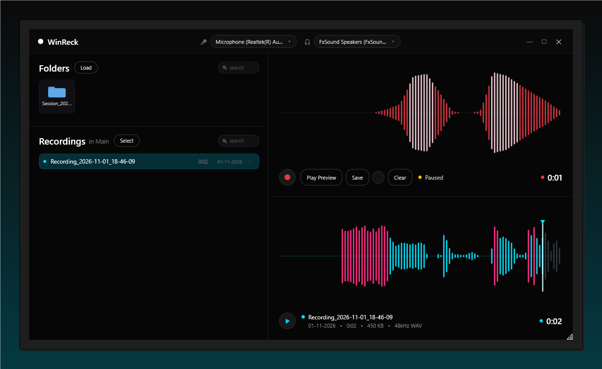
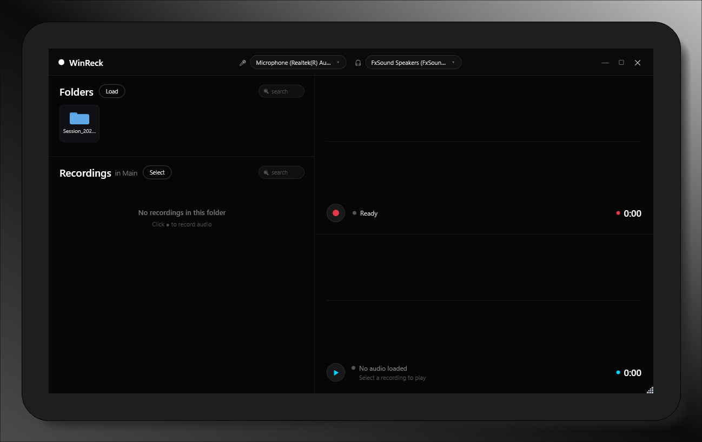
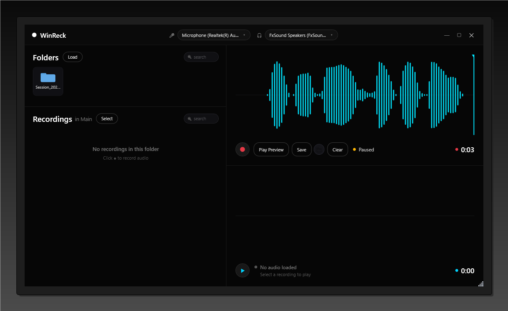
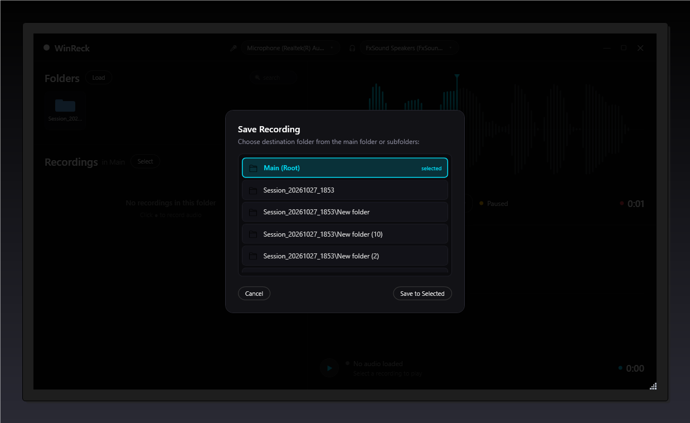

# WinReck

> The Windows audio recorder you have been searching for.



A native WPF audio recorder for Windows — clean dark UI, live waveform, seekable playback, and a no-nonsense recordings library.

---

## Screenshots








---

## Installation

[](https://sourceforge.net/projects/winreck/files/latest/download)

Download the latest self-contained `.exe` from [SourceForge](https://sourceforge.net/projects/winreck/files/latest/download) or [GitHub Releases](../../releases) — no .NET install required.

---

## Build from Source

**Requirements:** Windows 10/11 · [.NET 9 SDK](https://dotnet.microsoft.com/download/dotnet/9.0)

```bash
git clone https://github.com/Tharunz/WinReck.git
cd WinReck/WinReckApp
dotnet build
dotnet run
```

### Publish self-contained EXE

```bash
cd WinReckApp
dotnet publish -c Release -r win-x64 --self-contained true -p:PublishSingleFile=true -o ../release
```

The output `release/WinReckApp.exe` is fully portable — no runtime needed.

---

## License

MIT
