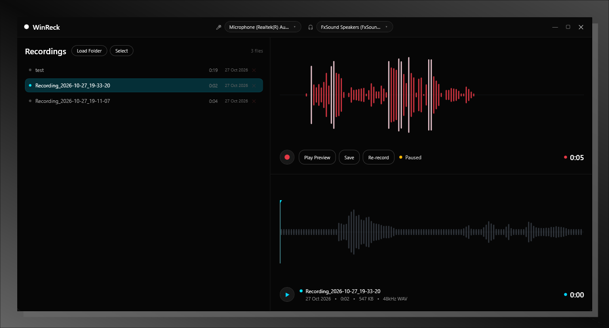

# WinReck

> The Windows audio recorder you have been searching for.



A native WPF audio recorder for Windows — clean dark UI, live waveform, seekable playback, and a no-nonsense recordings library.

---

## Features

- 🎙️ Record from any input device with live waveform visualization
- 🔊 Playback with seekable, scrollable waveform and playhead
- 📁 Recordings library with inline rename, delete, and batch selection
- 💾 Saves as 48kHz 16-bit stereo WAV to `~/Music/WinReck Recordings/`
- 🎨 Dark theme, zero OS dialogs

---

## Installation

Download the latest self-contained `.exe` from [Releases](../../releases) — no .NET install required.

---

## Build from Source

**Requirements:** Windows 10/11 · [.NET 9 SDK](https://dotnet.microsoft.com/download/dotnet/9.0)

```bash
git clone https://github.com/Tharunz/WinReck.git
cd WinReck/WinReckApp
dotnet build
dotnet run
```

### Publish self-contained EXE

```bash
cd WinReckApp
dotnet publish -c Release -r win-x64 --self-contained true -p:PublishSingleFile=true -o ../release
```

The output `release/WinReckApp.exe` is fully portable — no runtime needed.

---

## License

MIT
